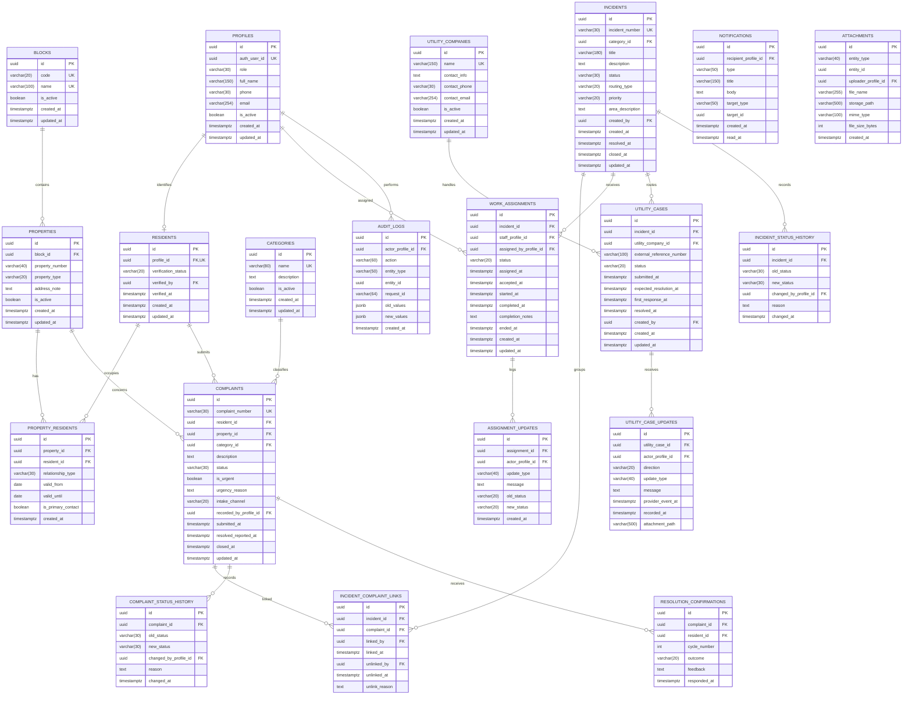

# Column-Level Data Dictionary & Relational Schema

**Project**: Housing Society Complaint Management System (Gulistan-e-Jauhar, Karachi)  
**Academic Context**: DBMS Course, Dawood University of Engineering and Technology  
**Database**: PostgreSQL 15+ (Hosted on Supabase)

---

## 1. Relational ERD (Mermaid)

---

## 2. Integrity Constraints & Invariants

1. **`uq_properties_block_number`**: `UNIQUE(block_id, property_number)` ensures unique property addresses within a block.
2. **`uq_active_incident_link_per_complaint`**: Partial unique index on `incident_complaint_links (complaint_id) WHERE unlinked_at IS NULL`. Guarantees a complaint can belong to at most one open incident, while retaining historic links.
3. **`uq_utility_case_provider_reference`**: Partial unique index on `utility_cases (utility_company_id, external_reference_number) WHERE external_reference_number IS NOT NULL`. Prevents duplicate tracking references per provider.
4. **`uq_resolution_confirmations_complaint_cycle`**: `UNIQUE(complaint_id, cycle_number)` enforces independent feedback per resolution attempt.
5. **No Cascading Hard Deletes**: Foreign keys default to `ON DELETE RESTRICT` (and `SET NULL` for actor audit contexts) to preserve historical integrity.
